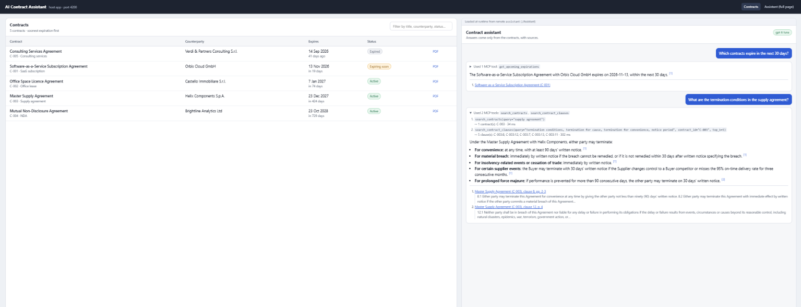
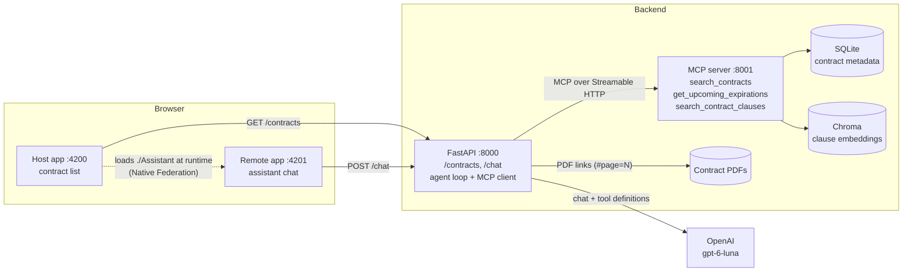
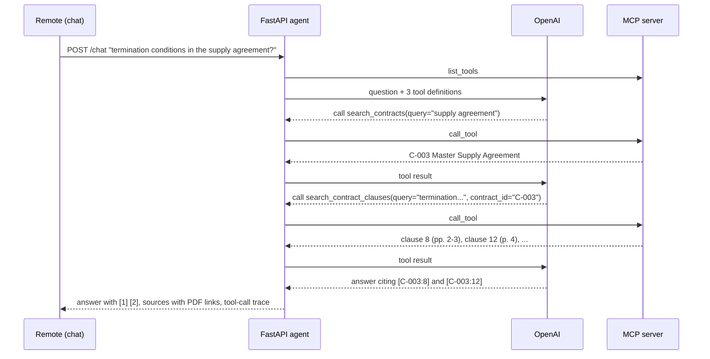

# AI Contract Assistant

A small end-to-end prototype for browsing contracts and asking questions about them:

- **Contract list.** Title, counterparty, expiration date and status, served from SQLite.
- **AI assistant with RAG.** Answers come only from the contract PDFs, cite the source clause and page, and say
  when the evidence is insufficient.
- **MCP server.** `search_contracts`, `get_upcoming_expirations` and `search_contract_clauses`. The LLM decides which
  tools to call; nothing about the contracts is put in the prompt.
- **Federated Angular frontend.** A host app and a remote app wired with Native Federation. The assistant is the
  remote, loaded into the host at runtime.



*The host (port 4200) with the real model (`gpt-6-luna`): the assistant panel is loaded at runtime from the remote.
For the supply-agreement question the model called `search_contracts` and then `search_contract_clauses`, and every
statement is cited to the clause and pages.*

**Contents:**
[Quick start](#quick-start) ·
[Configuration](#configuration) ·
[Architecture](#architecture) ·
[How RAG works](#how-rag-works) ·
[How the assistant uses the MCP tools](#how-the-assistant-uses-the-mcp-tools) ·
[Native Federation](#frontend-and-native-federation) ·
[Mock mode](#mock-mode) ·
[Results with the real model](#results-with-the-real-model) ·
[Design decisions](#key-design-decisions) ·
[Tests](#tests) ·
[Troubleshooting](#troubleshooting) ·
[Limitations](#limitations-and-next-steps) ·
[Project layout](#project-layout)

---

## Quick start

**Prerequisites:**
- Python 3.10 or newer
- Node.js 22.22+, 24.15+ or 26 (required by Angular 22)
- Optionally, an OpenAI API key. Without one the app runs in [mock mode](#mock-mode).

The commands are for Windows PowerShell; macOS/Linux equivalents are in the comments.

### 1. Backend setup (once)

```powershell
cd backend
py -m venv .venv                      # macOS/Linux: python3 -m venv .venv
.venv\Scripts\Activate.ps1            # macOS/Linux: source .venv/bin/activate
pip install -r requirements.txt

copy .env.example .env                # macOS/Linux: cp .env.example .env
notepad .env                          # set LLM_API_KEY=sk-...  (leave empty for mock mode)

python -m scripts.generate_contracts  # 5 sample contract PDFs, dates relative to today
python -m scripts.ingest              # SQLite + PDF -> Markdown -> clause chunks -> vector index
```

The first `ingest` downloads the local embedding model, about 80 MB, into `~/.cache/chroma`.

### 2. Run the three processes, each in its own terminal

| Terminal | Command | Serves |
|---|---|---|
| 1 | `cd backend`, activate the venv, `python -m mcp_server` | MCP server on http://127.0.0.1:8001/mcp |
| 2 | `cd backend`, activate the venv, `uvicorn app.main:app --reload --port 8000` | API on http://localhost:8000 (docs at `/docs`) |
| 3 | `cd frontend`, `npm install` (first time), `npm start` | Remote on http://localhost:4201, host on http://localhost:4200 |

Open **http://localhost:4200** and click one of the example questions.

### 3. Optional checks

```powershell
python -m scripts.check_mcp           # list the MCP tools and call each one (MCP server must be running)
python -m scripts.ask --demo          # the six demo questions from the command line (add --mock to force mock mode)
pip install -r requirements-dev.txt; python -m pytest    # 32 tests, no API key or server needed
npx @modelcontextprotocol/inspector   # official MCP Inspector: Streamable HTTP, http://127.0.0.1:8001/mcp
```

## Configuration

All settings live in `backend/.env`. It's created from `.env.example` and gitignored. Restart the API and the MCP
server after changing it.

| Setting | Default | Meaning |
|---|---|---|
| `LLM_API_KEY` | (empty) | API key. Empty means mock mode. `OPENAI_API_KEY` is also accepted. |
| `LLM_MODEL` | `gpt-6-luna` | Any model with tool calling in the Chat Completions API |
| `LLM_REASONING_EFFORT` | `none` | Sent as `reasoning_effort` (gpt-6-luna needs `none` for tool calling). Leave empty for providers that don't support it. |
| `LLM_BASE_URL` | OpenAI | Any OpenAI-compatible endpoint, e.g. Azure / Microsoft Foundry `https://<resource>.openai.azure.com/openai/v1/`, or Ollama `http://localhost:11434/v1` |
| `LLM_MODE` | `auto` | `auto` (real model if a key is set), `openai`, or `mock` |
| `AGENT_MAX_ROUNDS` | `5` | Maximum model ↔ tool round trips per question |
| `RETRIEVAL_MIN_SCORE` | `0.25` | Clause matches below this similarity count as "no evidence" |
| `MCP_SERVER_URL` | `http://127.0.0.1:8001/mcp` | Where the API reaches the MCP server |
| `CORS_ORIGINS` | `http://localhost:4200,http://localhost:4201` | Frontend origins allowed to call the API |
| `DATA_DIR` | `backend/data` | Where generated PDFs, SQLite and the index are stored |

The frontend's API address is `API_BASE_URL` in `frontend/projects/*/src/app/config.ts`. The remote's address is in
`frontend/projects/shell/public/federation.manifest.json`.

## Architecture



| Component | Code | What it does |
|---|---|---|
| Sample data | `backend/sample_contracts/`, `scripts/generate_contracts.py` | Turns text templates into realistic PDFs plus `metadata.json`, with dates relative to today |
| Ingestion | `backend/app/ingestion/`, `scripts/ingest.py` | Loads SQLite. Then PDF → per-page Markdown → clause chunks with page ranges → embeddings |
| API | `backend/app/main.py`, `routers/` | `GET /contracts`, `GET /contracts/{id}`, `GET /contracts/{id}/pdf`, `POST /chat`, `GET /health` |
| Agent | `backend/app/agent.py`, `llm.py`, `mock_llm.py` | The tool-calling loop, citation checking, and the real and mock model clients |
| MCP server | `backend/mcp_server/server.py` | The three tools, over Streamable HTTP, as a separate process |
| Host | `frontend/projects/shell` | Layout, contract list, loads the remote |
| Remote | `frontend/projects/assistant` | The chat, exposed as `./Assistant` |

## How RAG works

**Ingestion** runs once, in `python -m scripts.ingest`:

1. **PDF → Markdown, page by page.** [pymupdf4llm](https://pypi.org/project/pymupdf4llm/) runs layout analysis, so
   running headers and footers ("CONFIDENTIAL", "Page 3 of 5") are recognised and dropped. A second, generic pass
   removes any short line repeating on most pages, in case one slips through. Clause headings come out as Markdown
   headings. The result is saved to `backend/data/extracted/<id>.md`, which is exactly what the model can see.
2. **One chunk per clause.** A chunk starts at a heading like `8. Termination`. Sub-clauses (8.1, 8.2...) stay with
   their clause, so each chunk is a complete legal unit. Every chunk records its page range: the supply agreement's
   termination clause crosses a page break and is cited as *clause 8, pp. 2-3*. Text before clause 1 becomes a
   "Parties and Background" chunk, and the signature block a "Signatures" chunk.
3. **Embeddings.** Each chunk's contract title, clause heading and text are embedded with `all-MiniLM-L6-v2`
   (Chroma's default model, running locally through ONNX, so no API key) and stored in a local Chroma collection,
   using cosine similarity. Metadata carries the contract id, clause, page range and a ready-made citation.

**Retrieval** is the `search_contract_clauses` MCP tool, so the model decides when to read the contracts:

- **Inside one contract:** `contract_id` restricts the search.
- **Across every contract:** `group_by_contract=true` searches each contract separately and returns its best
  clauses. That's how "which contracts renew automatically?" checks all five contracts instead of returning the top
  five chunks from two of them.
- **Weak matches:** matches scoring below 0.25 are dropped. If nothing passes, the tool returns the closest few,
  flagged `weak_matches_only`, so the model can rephrase or report insufficient evidence.

**Grounding** happens in the agent:

- **The prompt rules:** answer only from tool results, cite every statement, and say plainly when the contracts
  don't provide enough evidence.
- **The citation check:** the backend keeps only citations that match a tool result, as described in the next
  section.

## How the assistant uses the MCP tools

`backend/app/agent.py` runs one loop per question:

1. **Discover the tools.** Connect to the MCP server (Streamable HTTP) and call `list_tools`. Each tool's name,
   description and JSON schema become a Chat Completions function definition. The tool descriptions are written as
   documentation (what the tool does, when to use it, what it returns), because that's what the model reads.
2. **Ask the model.** Send the system prompt, earlier turns and the question, plus the tool definitions. The prompt
   contains rules and today's date only, never contract data.
3. **Run the calls the model picks.** Execute each tool call through MCP, append the JSON result and ask again, until
   the model answers in text (at most `AGENT_MAX_ROUNDS`). Invalid arguments and unknown tools go back to the model
   as errors.
4. **Check the citations.**
   - The model cites `[C-003:8]` for a clause or `[C-001]` for contract data.
   - Only ids that appeared in this conversation's tool results are kept. They're renumbered `[1]`, `[2]`... and get
     a label, a quote and a link that opens the PDF at the cited page.
   - Invented ids are removed and reported in `warnings`, and `grounded: false` flags an answer with no sources.



The response includes the **tool-call trace** (tool, arguments, result summary, duration), which the chat shows above
each answer, and the MCP server logs every call on its console. Provider errors (bad key, quota, unsupported model)
come back as `502` with the provider's message; an unreachable MCP server gives `503` with the command to start it.

### MCP tools

| Tool | Input | Returns |
|---|---|---|
| `search_contracts` | `query` (words matched against title, counterparty and type), `status` (`Active` / `Expired`), both optional | Matching contracts with dates, status and days until expiration |
| `get_upcoming_expirations` | `days` (0-3650) | Active contracts expiring between today and today + `days`, soonest first. The date maths happens here, not in the model. |
| `search_contract_clauses` | `query`, optional `contract_id`, `group_by_contract`, `top_k` | Matching clauses with text, citation (contract, clause, pages) and similarity score |

The server is built with the official Python SDK (`mcp`, v1 line) and runs as its own process. Any MCP client can use
it, e.g. the MCP Inspector, VS Code or Claude Code, pointed at `http://127.0.0.1:8001/mcp`. Results are structured
JSON matching each tool's output schema, and inputs are validated (`days=-5` is rejected).

## Frontend and Native Federation

`frontend/` is one Angular 22 workspace with two applications, wired with
[Native Federation](https://www.npmjs.com/package/@angular-architects/native-federation) v22. It uses browser-native
ES modules and import maps on Angular's esbuild builder.

| App | Role | Port | Contents |
|---|---|---|---|
| `projects/shell` | host | 4200 | Header, routing, contract list, a panel hosting the remote |
| `projects/assistant` | remote | 4201 | Chat with example questions, model badge, tool-call trace, answers with citations that open the PDF at the cited page |

**How it's configured:**

- **The remote exposes a component.** `projects/assistant/federation.config.mjs` has
  `exposes: { './Assistant': './projects/assistant/src/app/assistant/assistant.component.ts' }`. Its build publishes
  `remoteEntry.json`, which describes the exposed module and the shared packages.
- **The host is a dynamic host.** `projects/shell/public/federation.manifest.json` maps remote names to URLs
  (`"assistant": "http://localhost:4201/remoteEntry.json"`) and is read at runtime. Another environment only needs a
  different manifest, not a rebuild.
- **Startup.** `projects/shell/src/main.ts` calls `initFederation('federation.manifest.json')` and passes the returned
  federation instance into Angular (`bootstrap.ts` provides it as the `FEDERATION` token). Components then call
  `federation.loadRemoteModule('assistant', './Assistant')`, the API Native Federation v4 recommends.
- **Two integration points, one remote component.**
  - The dashboard panel (`remote-assistant.ts`) loads it and renders it with `NgComponentOutlet`.
  - The `/assistant` route mounts it as a full page through `loadComponent`.
- **Shared dependencies.** Angular, RxJS and tslib are shared as strict-version singletons, so the page runs one copy
  of Angular. The animation entry points of `@angular/platform-browser` are skipped because the app doesn't use
  `@angular/animations`.
- **A self-contained remote.**
  - It calls the API with `fetch` and needs no providers from the host, so any host can mount it.
  - Its styles are component-scoped and travel with it.
  - Answers are rendered from a small parsed model (paragraphs, lists, bold, citations), never as raw HTML.
- **Independence.** The host has no build-time dependency on the remote's code. If the remote is down, the host still
  starts, the contract list still works, and the panel explains how to start the remote. The remote also runs on its
  own at http://localhost:4201.

## Mock mode

When no API key is set (or `LLM_MODE=mock`), a rule-based stand-in replaces the model behind the same interface
(`backend/app/mock_llm.py`):

- **Everything else is real:** the agent loop, the MCP calls, retrieval, citation checking and the UI.
- **Tool choice:** keyword rules pick the tools a model would, including multi-step plans (finding a contract's id,
  then searching its clauses).
- **Answers** quote the retrieved clauses instead of reasoning about them. When no clause mentions the topic, it
  reports insufficient evidence.
- **Clearly labelled:** answers end with a note, the API reports `mode: "mock"`, and the UI shows a "Mock mode" badge.

Mock mode exists for trying the app and the API without a key. It's not a replacement for the model.

## Results with the real model

`python -m scripts.ask --demo` with `gpt-6-luna`. Every tool choice below was made by the model.

| Question | Tools the model called | Answer |
|---|---|---|
| Which contracts expire in the next 30 days? | `get_upcoming_expirations(days=30)` | The SaaS agreement with Orbis Cloud (C-001) |
| Which contracts renew automatically? | `search_contract_clauses(group_by_contract=true)` | C-001 (12-month renewals, 30 days' notice) and C-003 (12-month renewals, 6 months' notice), each cited to its renewal clause |
| What are the termination conditions in the supply agreement? | `search_contracts("supply agreement")` → `search_contract_clauses(contract_id="C-003")` | All of clause 8 (pp. 2-3): convenience with 90 days' notice, breach, insolvency, buyer-specific rights. Also the force-majeure exit in clause 12. |
| Show me all contracts with Helix | `search_contracts("Helix")` | C-003, with dates and status |
| What are the termination conditions in the NDA? | `search_contracts("NDA")` → `search_contract_clauses(contract_id="C-004")` | The NDA only has a fixed 36-month term; *"the available text does not specify early termination rights or conditions"* |
| Of the contracts expiring in the next 90 days, which renew automatically? | `get_upcoming_expirations(days=90)` → `search_contract_clauses(group_by_contract=true)` | C-001 renews automatically; C-002 (office licence) does not. Both cited. |

No invented citations were removed in this run: every id the model cited had come back from a tool.

## Key design decisions

The alternatives considered for each decision, and what each choice gives up, are in
[docs/design-decisions.md](docs/design-decisions.md).

| Decision | Why |
|---|---|
| **Contracts are PDFs**, generated from templates at setup time | Real contracts are PDFs, and page-level citations need pages. Generating them keeps every date relative to today, so "next 30 days" always has an answer, and keeps the PDF text and the list metadata consistent. Ingestion only reads the PDFs, never the templates. |
| **One chunk per clause** with page ranges | A clause is the natural unit of legal meaning and gives clean citations ("clause 8, pp. 2-3"). Fixed-size chunks would split clauses mid-sentence. |
| **Local embeddings** in Chroma | No API key is needed for retrieval, so mock mode and reviewers without a key still get real search. Chroma gives persistence and metadata filtering in a few lines. |
| **Retrieval is an MCP tool**, not an always-on step | The model decides when to read the contracts, so one loop handles metadata questions, content questions and multi-step combinations. Always injecting passages would put dates from contract text in front of the model and tempt it to skip the expiration tool. |
| **Per-contract retrieval** (`group_by_contract`) | Questions about every contract can't silently miss one, which plain top-k retrieval can. |
| **MCP over Streamable HTTP**, as a separate process | It's a real MCP server that any client can use and that can be tested on its own (MCP Inspector, `check_mcp`). It also avoids subprocess issues with stdio on Windows. |
| **Hand-written agent loop** (about 100 lines) instead of a framework | Every step is visible and explainable. Citation checking, the round limit and the tool trace are easy to add. There's no framework version churn. |
| **Chat Completions API**, configurable endpoint | The same client works with OpenAI, Azure / Microsoft Foundry, Groq or Ollama. `gpt-6-luna` is OpenAI's cheapest current model and supports tool calling here with `reasoning_effort: none`. |
| **Citations checked against tool results** | The model can't cite a clause it never retrieved. Invented ids are dropped and reported. |
| **Remote = assistant**, host = contract list | The assistant is the reusable piece, an AI widget any federated shell can mount. That's the integration story the brief asks to demonstrate. |
| **Dynamic host** (runtime manifest) | Remote URLs change per environment without rebuilding the host. |
| **Status derived from today's date** | A contract that passes its expiration date shows as Expired without re-running setup. |

## Tests

```powershell
cd backend
pip install -r requirements-dev.txt
python -m pytest
```

There are 32 tests and they run in about five seconds, with no API key or running server needed:

- **Chunking:** one chunk per clause, page ranges across a page break, heading detection, header/footer removal.
- **PDF round trip:** a generated contract → extraction → chunks. The supply agreement's termination clause is on
  pp. 2-3, and the NDA contains no termination wording.
- **Queries:** expiration windows are inclusive and exclude expired contracts, status is derived from today, and
  search ignores filler words.
- **Citations:** valid ids are renumbered by first appearance, invented ids are removed with a warning, and ordinary
  brackets are left alone.
- **Mock mode:** it picks the right tools, resolves contract names first, and reports insufficient evidence.

The API, the MCP server (including the official MCP Inspector), the OpenAI code path (against a stub server) and the
frontend (in a headless browser) were also checked end to end during development.

## Troubleshooting

| Symptom | Fix |
|---|---|
| `running scripts is disabled on this system` (venv activation or `npm`) | Run `Set-ExecutionPolicy -Scope CurrentUser RemoteSigned` once in PowerShell |
| `ingest` fails with a file-in-use error, or old answers persist after re-running it | Stop the MCP server first (Windows locks the index files), run `ingest`, start the server again |
| The chat says `Cannot reach the MCP server` (503) | Start it: `python -m mcp_server` in `backend` |
| The chat shows a model error (502) | Check `LLM_API_KEY`, billing or quota, and `LLM_MODEL` in `backend/.env`, then restart `uvicorn` |
| The panel says "The assistant remote is not available" | Start the remote (`npm run start:assistant`, or `npm start` for both) and reload |
| "Cannot load contracts" or "API offline" in the UI | Start the API: `uvicorn app.main:app --reload --port 8000` in `backend` |
| A port is already in use | Stop the other process, or change `MCP_PORT` / the `--port` flag (and `MCP_SERVER_URL` / the manifest accordingly) |
| Opening `http://127.0.0.1:8001/mcp` in a browser shows 404/406 | Expected: it's an MCP endpoint, not a web page. Use `check_mcp` or the MCP Inspector. |

## Limitations and next steps

- **Text-based PDFs only.** Scanned contracts need OCR, and tables and multi-column layouts aren't handled.
- **Small embedding model.** Very casual phrasing ("get out of the deal early") can score low. The tool description
  asks the model to search in contract language, which works in practice. A larger embedding model, or hybrid
  keyword + vector search, would be the next improvement.
- **List metadata comes from the generator's `metadata.json`.** With real contracts it would come from a contract
  management system, or be extracted from the PDFs by the model and reviewed by a person.
- **Chat Completions only.** OpenAI's larger GPT-6 models (`gpt-6.1-sol`, `gpt-6-astra`) support tool calling only in
  the Responses API. Supporting them means adding a second client behind the same interface.
- **Out of scope, as the brief says:** authentication, deployment, Docker, an upload screen, streaming answers,
  polished visual design.
- **Licensing.** PyMuPDF / pymupdf4llm are AGPL-3.0. That's fine for a prototype; a product would need a commercial
  licence or a permissive extractor such as `pypdf`.

## Project layout

```
backend/
  app/
    main.py                   FastAPI app: CORS, error handling, routers, /health
    config.py                 settings (from .env) and file locations
    db.py                     SQLite contract store, status derived from today's date
    queries.py                contract search and expiration look-ups (behind the MCP tools)
    retrieval.py              Chroma index: build, semantic clause search, evidence threshold
    agent.py                  the assistant: tool-calling loop, system prompt, citation checking
    llm.py                    OpenAI-compatible Chat Completions client
    mock_llm.py               rule-based stand-in used in mock mode
    mcp_client.py             MCP client: connect, list tools, call tools
    schemas.py                API request/response models
    routers/                  contracts.py (/contracts + PDFs), chat.py (/chat)
    ingestion/                pdf_extract.py (PDF -> Markdown), chunking.py (clause chunks)
  mcp_server/server.py        MCP server and tool definitions
  sample_contracts/           sample-data generator only: templates/, builder.py, pdf_writer.py
  scripts/                    generate_contracts, ingest, check_mcp, ask
  tests/                      pytest suite
  .env.example                settings template (copy to .env)
  requirements.txt, requirements-dev.txt
frontend/
  package.json                npm start runs both apps
  projects/shell/             host (4200): federation.config.mjs, public/federation.manifest.json,
                              src/main.ts (initFederation), src/app/federation.ts, contracts/, remote-assistant/
  projects/assistant/         remote (4201): federation.config.mjs (exposes ./Assistant),
                              src/app/assistant/ (chat component, API client, answer formatter)
docs/
  design-decisions.md         alternatives considered for each design decision
  screenshot.png
```

### Sample contracts

All companies and people are fictional. Dates are relative to the day `generate_contracts` runs.

| ID | Contract | Counterparty | Expires | Built to test |
|---|---|---|---|---|
| C-001 | SaaS Subscription Agreement | Orbis Cloud GmbH | in 20 days | 30-day expirations; auto-renewal |
| C-002 | Office Space Licence Agreement | Castello Immobiliare S.r.l. | in 75 days | 90-day window; no auto-renewal |
| C-003 | Master Supply Agreement | Helix Components S.p.A. | in ~14 months | auto-renewal; termination clause spanning two pages |
| C-004 | Mutual Non-Disclosure Agreement | Brightline Analytics Ltd | in ~2 years | no termination clause, so "insufficient evidence" |
| C-005 | Consulting Services Agreement | Verdi & Partners Consulting S.r.l. | 40 days ago | expired status |

### Version notes

- **`mcp` stays on the v1 line** (`>=1.30,<2`). Version 2 (August 2026) renamed the main classes, and most examples
  and tooling still target v1.
- **`pymupdf4llm` is pinned to `1.28.2`.** It requires the exact matching PyMuPDF version, and the unpinned latest
  release (`2.0`) installs an empty package.
- **Native Federation 22.2 matches Angular 22.2.** Keep the two on the same minor version when upgrading.
